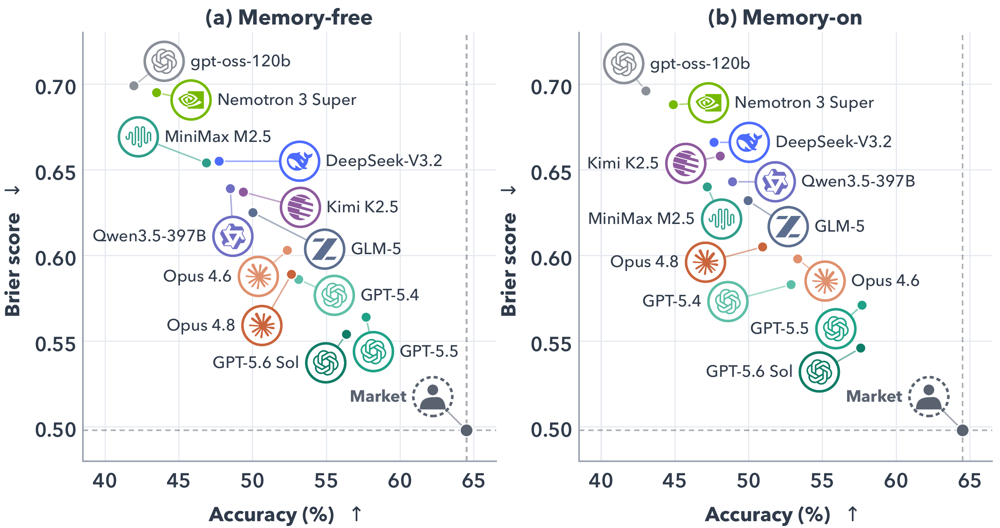
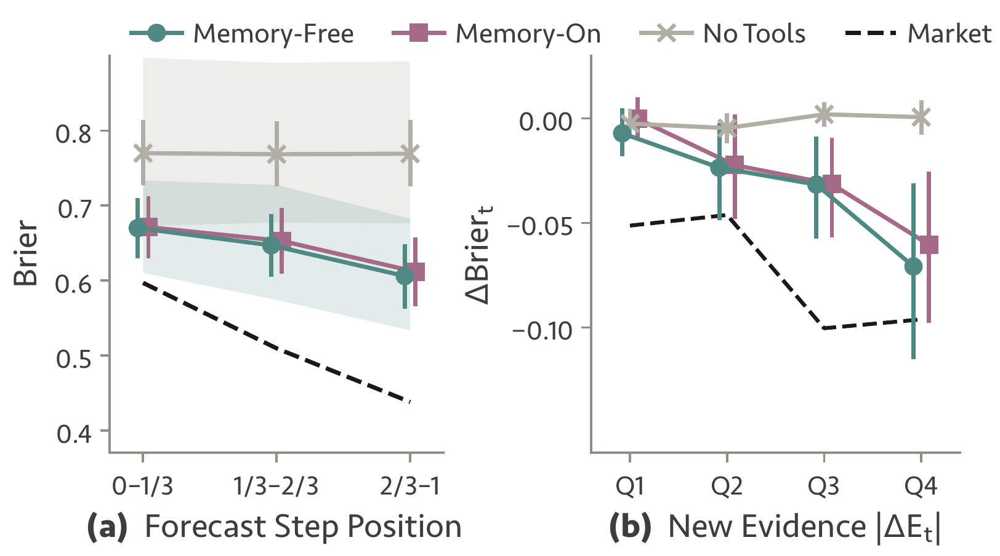
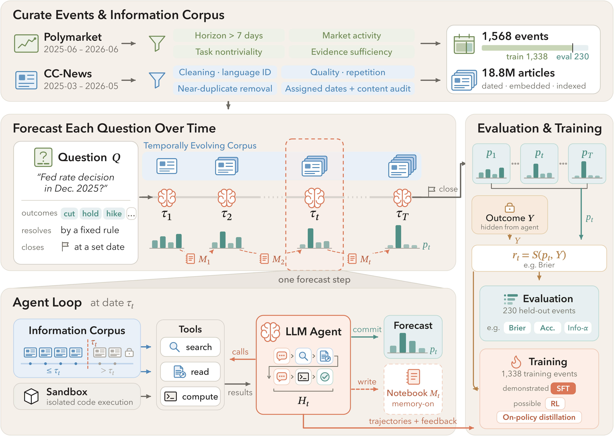
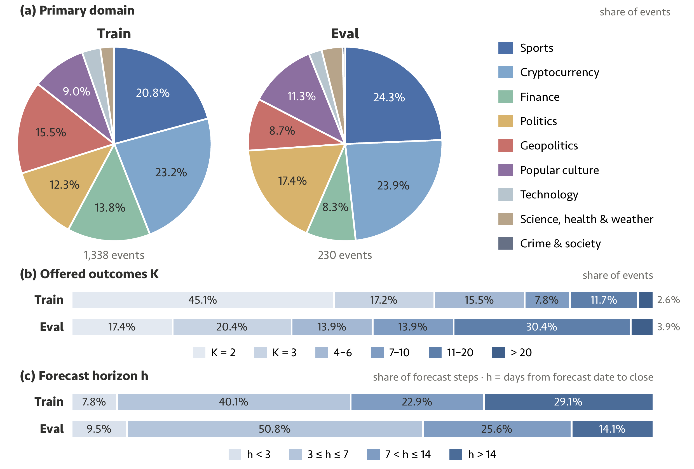

<h1 align="center">
  <sub></sub> Forecast-Dojo: Replayable Environments for<br>
  Benchmarking and Training LLM Forecasting Agents
</h1>

<p align="center">
  <a href="https://arxiv.org/abs/2609.28876"></a>
  <a href="https://forecast-dojo.github.io/"></a>
  <a href="https://huggingface.co/datasets/liqinye/Forecast-Dojo"></a>
  <a href="LICENSE"></a>
</p>

<p align="center">
  Liqin Ye<sup>*1</sup> · Haorui Wang<sup>*1</sup> · Fardin Ahmed<sup>1</sup> · Rongzhi Zhang<sup>†2</sup> · Yuan He<sup>†2</sup> · Ziyuan Lin<sup>3</sup> · Yanbin Yin<sup>1</sup> · Jing Peng<sup>1</sup> · Michael Galarnyk<sup>1</sup> · Sudheer Chava<sup>1</sup> · Chao Zhang<sup>1</sup><br>
  <small><sup>1</sup>Georgia Institute of Technology &nbsp;·&nbsp; <sup>2</sup>Amazon &nbsp;·&nbsp; <sup>3</sup>University of Florida &nbsp;·&nbsp; <sup>*</sup>Equal contribution &nbsp;·&nbsp; <sup>†</sup>Work done outside Amazon</small>
</p>

<p align="center"></p>

Forecast-Dojo replays 1,568 resolved Polymarket events as sequences of dated forecast steps. At each step an LLM agent searches and reads only news published by that day, runs Python, optionally carries a belief notebook from the previous step, and commits a probability forecast that is scored against the hidden outcome. Any model can be run on the same steps, scored immediately, and its trajectories reused for training.

<div align="center">
<table>
  <thead>
    <tr><th>Research tools</th><th>As events unfold</th><th>Market reference</th><th>Training</th></tr>
  </thead>
  <tbody>
    <tr>
      <td align="center">Brier lower for <b>12 / 12</b> models</td>
      <td align="center">Brier 0.670 → <b>0.606</b>, first to last third (memory-free)</td>
      <td align="center">best model <b>0.546</b> vs. market 0.498</td>
      <td align="center">SFT accuracy 34.8 → <b>42.8%</b></td>
    </tr>
  </tbody>
</table>
</div>

- **Environment**: every event is a fixed schedule of 3 to 10 historical dates; the agent has `search`, `scrape` and `python` over 18.8M dated CC-News articles, an optional belief notebook between dates, and never sees the outcome or the market prices.
- **Data**: 1,568 events with 6,122 forecast steps, split by time into 1,338 training and 230 evaluation events, with market references where available. The pipelines that build the events and the news index are in this repository.
- **Findings**: research tools lower Brier for all 12 models; forecasts improve as events unfold, most at steps with more new evidence; every model trails the market; a belief notebook cuts API cost (median 24% across the five priced models) without reliably improving Brier; SFT on collected trajectories improves a 30B student.

**Updates** · `[2026/10]` Interactive leaderboard and per-question trajectories on the [website](https://forecast-dojo.github.io/), trajectories on [Hugging Face](https://huggingface.co/datasets/liqinye/Forecast-Dojo-Trajectories) · `[2026/09]` Paper on [arXiv](https://arxiv.org/abs/2609.28876), events on [Hugging Face](https://huggingface.co/datasets/liqinye/Forecast-Dojo)

## Results

230 held-out events (797 forecast steps), four rollouts per step, identical schedules and tool budgets for every model. Means over recorded forecasts; unusable forecasts count as uniform. Bold: best model per column. <sup>†</sup>: over 5% unusable forecasts. Table 2 of the paper adds Information-α and rollout SDs.

<div align="center">
<table>
  <thead>
    <tr>
      <th rowspan="2" align="left">Model</th>
      <th colspan="2">No tools</th>
      <th colspan="2">Tools, memory-free</th>
      <th colspan="2">Tools, memory-on</th>
    </tr>
    <tr>
      <th>Brier ↓</th><th>Acc % ↑</th>
      <th>Brier ↓</th><th>Acc % ↑</th>
      <th>Brier ↓</th><th>Acc % ↑</th>
    </tr>
  </thead>
  <tbody>
    <tr><td colspan="7" align="left"><i>Proprietary</i></td></tr>
    <tr><td align="left">GPT-5.6 Sol</td><td align="center"><b>0.650</b></td><td align="center"><b>47.03</b></td><td align="center"><b>0.554</b></td><td align="center">56.36</td><td align="center"><b>0.546</b></td><td align="center">57.59</td></tr>
    <tr><td align="left">GPT-5.5</td><td align="center">0.698</td><td align="center">43.85</td><td align="center">0.564</td><td align="center"><b>57.69</b></td><td align="center">0.571</td><td align="center"><b>57.68</b></td></tr>
    <tr><td align="left">GPT-5.4</td><td align="center">0.708</td><td align="center">41.34</td><td align="center">0.586</td><td align="center">53.12</td><td align="center">0.583</td><td align="center">52.87</td></tr>
    <tr><td align="left">Claude Opus 4.8</td><td align="center">0.725</td><td align="center">40.30</td><td align="center">0.589</td><td align="center">52.63</td><td align="center">0.605</td><td align="center">50.94</td></tr>
    <tr><td align="left">Claude Opus 4.6</td><td align="center">0.762</td><td align="center">35.16</td><td align="center">0.603</td><td align="center">52.35</td><td align="center">0.598</td><td align="center">53.32</td></tr>
    <tr><td colspan="7" align="left"><i>Open-weight</i></td></tr>
    <tr><td align="left">GLM-5</td><td align="center">0.731</td><td align="center">38.54</td><td align="center">0.625</td><td align="center">50.02</td><td align="center">0.632</td><td align="center">49.96</td></tr>
    <tr><td align="left">Qwen3.5-397B</td><td align="center">0.759</td><td align="center">36.54</td><td align="center">0.639</td><td align="center">48.49</td><td align="center">0.643</td><td align="center">48.90</td></tr>
    <tr><td align="left">Kimi K2.5</td><td align="center">0.773</td><td align="center">36.30</td><td align="center">0.637</td><td align="center">49.37</td><td align="center">0.658</td><td align="center">48.07</td></tr>
    <tr><td align="left">MiniMax M2.5</td><td align="center">0.758</td><td align="center">35.68</td><td align="center">0.654<sup>†</sup></td><td align="center">46.87</td><td align="center">0.640</td><td align="center">47.19</td></tr>
    <tr><td align="left">DeepSeek-V3.2</td><td align="center">0.805</td><td align="center">34.34</td><td align="center">0.655</td><td align="center">47.73</td><td align="center">0.666</td><td align="center">47.65</td></tr>
    <tr><td align="left">gpt-oss-120b</td><td align="center">0.896</td><td align="center">32.44</td><td align="center">0.699<sup>†</sup></td><td align="center">41.95</td><td align="center">0.696<sup>†</sup></td><td align="center">43.03</td></tr>
    <tr><td align="left">Nemotron 3 Super</td><td align="center">0.882<sup>†</sup></td><td align="center">30.84</td><td align="center">0.695<sup>†</sup></td><td align="center">43.49</td><td align="center">0.688<sup>†</sup></td><td align="center">44.89</td></tr>
    <tr><td align="left">Uniform reference</td><td align="center">0.771</td><td align="center">22.9</td><td align="center">0.771</td><td align="center">22.9</td><td align="center">0.771</td><td align="center">22.9</td></tr>
    <tr><td align="left">Market reference</td><td align="center">0.498</td><td align="center">64.5</td><td align="center">0.498</td><td align="center">64.5</td><td align="center">0.498</td><td align="center">64.5</td></tr>
  </tbody>
</table>
</div>

Only tool-using agents improve as events unfold: mean Brier falls from 0.670 to 0.606 (memory-free) and from 0.671 to 0.612 (memory-on) between the first and last third of an event, while no-tools stays near 0.769 and the market moves from 0.597 to 0.438. The largest step-to-step gains come at steps with more newly recorded evidence.

<p align="center"></p>

**Training demonstration.** Qwen3-30B-A3B-Thinking-2507, fine-tuned on 3,965 memory-free demonstrations collected from Qwen3-235B-A22B-Thinking-2507 on 1,023 training events, improves on the 230 held-out events from Brier 0.924 to 0.749 and from 34.8% to 42.8% accuracy (paper Table 3). The harness collects such trajectories (step 5 below); the SFT recipe is in the paper's appendix and not part of this repository.

## How the environment works

<p align="center"></p>

- **Dated replay**: each event gets 3 to 10 forecast dates (about √n of its n eligible days), one per time bin, favoring days with market movement and news volume and ending two days before the recorded close. At each date the agent can retrieve only articles whose publication day is on or before that date.
- **Budgets**: 120 tool iterations and 400 tool calls per forecast step; 32,768 output tokens per model call with tools, 65,536 without.
- **Output and scoring**: the agent ends with `<answer>{"YES": 0.63, "NO": 0.37}</answer>`, strict JSON over the offered outcomes; the step is scored by multiclass Brier, top-label accuracy, log loss and Information-α against the outcome. Neither the outcome nor the market prices appear in the prompt.

The three tools, identical for every model:

| Tool | Returns | Limits |
|:--|:--|:--|
| `search(query, top_k=5)` | ids, titles, dates, scores and 280-character snippets from dense retrieval over the date window (Qwen3-Embedding-8B + FAISS) | `top_k` hits per call |
| `scrape(article_id)` | the full text of an article surfaced by this step's own searches | 8,000 tokens |
| `python(code)` | the output of a fresh sandboxed interpreter with numpy, pandas and scipy | 10 s, 4 GB, no network, no access to task files or the index |

Three modes. Every forecast step starts from a fresh context; only `memory-on` carries anything between dates:

| Mode | Tools | Carried across dates |
|:--|:--|:--|
| `no-tools` | none | nothing |
| `memory-free` | search, scrape, python | nothing |
| `memory-on` | search, scrape, python | the previous step's belief notebook: `assessment` (`p`, `open_questions`) and an append-only `evidence_ledger` |

## Dataset

<p align="center"></p>

Resolved Polymarket events, binary or mutually exclusive multi-option, whose full lifetimes fall between June 2025 and June 2026. An event is kept if its horizon exceeds 7 days, the market is active on most days, its price history is neither near-certain nor flat, and an LLM judge rates the evidence retrievable two days before close as sufficient with no outcome leakage. These filters reduce 13,671 training-window and 13,920 evaluation-window candidates to 1,338 and 230 events; the split is by lifetime, so no event is in both.

| Split | Events | Forecast steps | Binary / multi-option | Event lifetimes within | Forecast dates |
|:--|--:|--:|--:|:--|:--|
| Train | 1,338 | 5,325 | 602 / 736 | [2025-06-01, 2026-03-01) | 2025-06-02 to 2026-02-26 |
| Eval | 230 | 797 | 40 / 190 | [2026-03-01, 2026-06-01) | 2026-03-02 to 2026-04-29 |

One JSONL row per event: `event_id`, `slug`, `belief_kind` (`binary` or `multi_neg_risk`), `prompt`, `label`, and `metadata` with the question, `forecast_dates`, `crowd_probs` (market probability of the realized outcome at each date, `null` where unavailable), `crowd_distributions`, `domain` and `tags`. `label` and the market references are for scoring only. The [dataset card](https://huggingface.co/datasets/liqinye/Forecast-Dojo) documents every field.

The news side is 18.8M CC-News articles from March 2025 through May 2026, cleaned with a FineWeb-style pipeline, deduplicated and assigned a UTC publication day.

| Artifact | What it is | Download |
|:--|:--|:--|
| **Forecast-Dojo** | train and eval events with forecast schedules, outcomes and market references (CC-BY-4.0) | [liqinye/Forecast-Dojo](https://huggingface.co/datasets/liqinye/Forecast-Dojo) |
| **Forecast-Dojo-Trajectories** | every recorded forecast of the 12 models on the 230 evaluation events, with belief notebooks and tool-call records; the data behind the website (CC-BY-4.0) | [liqinye/Forecast-Dojo-Trajectories](https://huggingface.co/datasets/liqinye/Forecast-Dojo-Trajectories) |

> [!NOTE]
> The news corpus, the FAISS indexes and model checkpoints are not hosted. Rebuild the corpus with the pipeline under [Build the corpus and the events](#build-the-corpus-and-the-events).

## Installation

Python ≥ 3.10. The root package pins `strands-env==0.1.0+forecastdojo`, which resolves only from the local `strands-env/` directory, so install both together:

```bash
git clone https://github.com/Forecast-Dojo/Forecast-Dojo.git && cd Forecast-Dojo
pip install -e ./strands-env -e .
# optional extras: corpus pipeline, evidence check, GPU search server
pip install -e '.[corpus,evidence-check,gpu-search]'
```

> [!IMPORTANT]
> Tool-enabled modes need a Linux host with unprivileged user namespaces: the `python` tool isolates every call with `unshare` (util-linux), and its sandbox self-test fails closed. `no-tools` runs anywhere.

- vLLM is not declared as a dependency; install it, in its own environment if needed, for `scripts/serve_embeddings.sh`, `scripts/serve_model.sh` and `corpus.embed`.
- The install adds the console scripts `forecast-dojo` (harness), `dojo-score`, `dojo-build-data` and `dojo-data`.

## Evaluate a model

```text
download events → index + embedding server (→ open-weight model server) → evaluate → score
```

**1. Download the events** (`hf` is the Hugging Face CLI, `huggingface_hub` ≥ 0.34). The files land at `data/train.jsonl` and `data/eval.jsonl`, the harness defaults.

```bash
hf download liqinye/Forecast-Dojo data/train.jsonl data/eval.jsonl --repo-type dataset --local-dir .
```

**2. Point at the index and serve the embedding model.** Tool-enabled modes need the FAISS index root (`--index-root` or `FORECAST_INDEX_ROOT`, built under [Build the corpus and the events](#build-the-corpus-and-the-events)) and an embedding server (port 8001, served name `Qwen3-Embedding-8B`, the harness defaults). `no-tools` needs neither.

```bash
EMBEDDING_MODEL_PATH=/models/Qwen3-Embedding-8B bash scripts/serve_embeddings.sh
```

**3. Serve an open-weight model** (port 30000; skip for API models). `MODEL_NAME` must equal `model_id` in the config, and `TOOL_CALL_PARSER` is the model's vLLM tool-call parser.

```bash
MODEL_PATH=/models/<checkpoint> MODEL_NAME=glm-5 TOOL_CALL_PARSER=<parser> \
  bash scripts/serve_model.sh
```

**4. Evaluate.** The mode is the first argument; everything after it goes to `evaluation.run`. `configs/eval/` holds the 12 paper profiles (backend, `model_id`, reasoning effort, sampling); explicit flags override config values. A full configuration is 797 steps × 4 rollouts = 3,188 forecasts, and in the paper GPT-5.5 cost about $5.85 per memory-free forecast, so start with `--limit 2 --n-rollouts 1 --output results/smoke.jsonl`.

```bash
export FORECAST_INDEX_ROOT=/indexes/news-index
# ANTHROPIC_API_KEY for the Claude profiles, OPENAI_COMPATIBLE_API_KEY for hosted
# OpenAI-compatible endpoints; local servers need no key
export OPENAI_API_KEY=...
bash scripts/evaluate.sh no-tools    --config configs/eval/gpt-5.4.json   # needs only data/eval.jsonl and a key
bash scripts/evaluate.sh memory-free --config configs/eval/gpt-5.4.json
bash scripts/evaluate.sh memory-on   --config configs/eval/gpt-5.4.json
```

**5. Read the results.**

- Outputs: `results/<model_name>.<mode>.jsonl`, one row per rollout and forecast date (forecast, scores, termination reason, token and tool metrics, estimated API cost for the five priced models, `agent_trace` unless `--no-trace`); `<output>.manifest.json` holds the resolved configuration and `<stem>.calls.jsonl` every model call. A scorecard prints at the end.
- Resuming: re-running with the same `--output` skips rollouts already recorded; a changed configuration is rejected; rows recorded with an `error` are not retried (delete them or start a new file).
- Training trajectories: add `--questions-path data/train.jsonl --output results/<model>.train.<mode>.jsonl` to run on the training split.

**6. Re-score or compare runs.**

```bash
dojo-score results/gpt-5.4.memory-free.jsonl --output results/gpt-5.4.memory-free.scores.json
# paired difference: the --compare run minus the positional run
dojo-score results/gpt-5.4.no-tools.jsonl --compare results/gpt-5.4.memory-free.jsonl
```

- Reports: recorded, usable, errored and missing forecasts out of the 3,188 scheduled; top-label ECE; for Brier, accuracy, log loss and Information-α the mean, the SD across rollout means and a 95% event-level bootstrap CI (4,000 resamples, seed 0); uniform and market references from the dataset (`--dataset`, default `data/eval.jsonl`).
- Conventions: unusable forecasts score as uniform (Brier 1 − 1/K, accuracy 1/K); Information-α is log p(outcome) − log p<sub>market</sub>(outcome) with a 10<sup>−3</sup> floor; `--pair-rollouts` pairs on event, date and rollout for memory comparisons. `dojo-score` is `python -m evaluation.metrics`.

<details>
<summary>Command-line flags and environment variables</summary>
<br>

- `--config PATH`: JSON of defaults keyed by the flags' underscore names (`backend`, `model_id`, `reasoning_effort`, `sampling_params`, `model_name`, ...); unknown keys are rejected. `--questions-path` (default `data/eval.jsonl`), `--output`, `--limit N`, `--offset N`, `--run-id`
- `--backend {anthropic,openai,openai-compatible,sglang}` (default `openai`), `--model-id`, `--model-name`, `--base-url` (default `http://localhost:30000/v1` for `openai-compatible`, matching `serve_model.sh`; comma-separated replicas allowed), `--api-key-env`, `--tool-parser` and `--tokenizer-path` (sglang)
- `--reasoning-effort {none,low,medium,high,max,xhigh}`, `--no-thinking` (Anthropic), `--sampling-params JSON`, `--temperature`, `--max-new-tokens` (default 32,768 with tools, 65,536 without)
- `--index-root`, `--embedding-endpoint` (default `http://localhost:8001/v1`), `--embedding-model` (default `Qwen3-Embedding-8B`)
- `--max-tool-iters 120`, `--max-tool-calls 400`, `--n-rollouts 4`, `--concurrency 8`, `--system-prompt-path`, `--no-trace`
- `FORECAST_INDEX_ROOT`: default index root. `FORECAST_PYTHON_SANDBOX=off`: disable the Python sandbox (logged, written to the manifest, not valid benchmark numbers). `FORECAST_SEARCH_BACKEND=gpu` with `FORECAST_SEARCH_ENDPOINT` (default `http://localhost:8100`): route search to `bash scripts/serve_search.sh --index-root ...`. `FORECAST_TOOL_TRACE=all`: log every tool call.

</details>

## Build the corpus and the events

Every module prints `--help`. The corpus pipeline needs the `corpus` extra and GPUs for embedding; the evidence check needs the index, the embedding server, the `evidence-check` extra and `ANTHROPIC_API_KEY`.

**News corpus** (CC-News, March 2025 to May 2026). `bash scripts/build_corpus.sh {download|filter|embed} ...` wraps the same modules.

```bash
# WARCs into corpus/2025-03/
python -m corpus.download crawl --date 2025/03 --out-dir corpus
# extract text and dates, one feather per WARC (WARCs are deleted after parsing unless --keep-warc)
python -m corpus.filter parse --data-dir corpus/2025-03 --keep-warc
# clean, English, Gopher/C4/FineWeb filters, URL/title/MinHash dedup
python -m corpus.filter pipeline --date 2025-03
# one feather per publication day, cross-month dedup
python -m corpus.filter reshard-daily --input-root corpus --out-dir days \
  --window-start 2025-03-01 --window-end 2026-05-31
# Qwen3-Embedding-8B + FAISS, one shard per input
python -m corpus.embed --data-root days --index-root /indexes/news-index --skip-existing
```

`pipeline` reads `$FORECAST_CORPUS_ROOT` (default `corpus`) and the fastText model at `LID_MODEL_PATH` (default `models/lid.176.bin`). `corpus.embed` names each shard after its input: a `YYYY-MM-DD.feather` gives a daily shard, a `YYYY-MM.feather` file or `YYYY-MM/` directory of feathers a monthly shard with `day_offsets` (the paper used monthly indexes). The retriever reads either layout:

```text
/indexes/news-index/
├── 2025-03/                 # or 2025-03-01/, one directory per shard
│   ├── faiss.index
│   ├── texts.parquet
│   └── metadata.json        # monthly shards carry day_offsets
└── build_summary.json
```

**Events** (Polymarket). The `--window` arguments below are the paper's splits.

```bash
# resolved binary and negRisk multi-option events
python -m data.collect_events --start-date 2025-06-01 --end-date 2026-06-01 --output events.jsonl
# hourly prices to a daily market belief
python -m data.collect_prices --input events.jsonl --output prices.jsonl
# daily trades and shares
python -m data.collect_volume --input prices.jsonl --output volume.jsonl
# split by full lifetime; boundary-spanning events dropped
python -m data.split --input volume.jsonl --window train:2025-06-01:2026-03-01:train.jsonl \
  --window eval:2026-03-01:2026-06-01:eval.jsonl
# horizon of at least 8 days
python -m data.filter_lifetime --input train.jsonl --output f1.jsonl
# trades, shares, coverage and inactive-run thresholds
python -m data.filter_activity --input f1.jsonl --output f2.jsonl
# drop near-certain and flat markets
python -m data.filter_signal --input f2.jsonl --output f3.jsonl
```

**Evidence check and schedules**

```bash
python -m data.evidence_check.build_bm25 --index-root /indexes/news-index --bm25-root /indexes/bm25
# 4 to 7 evidence and 4 to 7 context queries per event
python -m data.evidence_check.decompose --input f3.jsonl --output decomposed.jsonl
# dense + BM25, RRF to 15 documents, as of two days before close
python -m data.evidence_check.retrieve --questions f3.jsonl --decompositions decomposed.jsonl \
  --output retrieved.jsonl --index-root /indexes/news-index --bm25-root /indexes/bm25
# SUFFICIENT / PARTIAL / INSUFFICIENT and a leakage flag
python -m data.evidence_check.judge --questions f3.jsonl --retrieved retrieved.jsonl \
  --output judged.jsonl
python -m data.evidence_check.select_evidence --signal f3.jsonl --judged judged.jsonl \
  --output selected.jsonl
# 3 to 10 dates per event
dojo-build-data --input selected.jsonl --output tasks.jsonl --auto-k --news-volume \
  --index-root /indexes/news-index
# validate schedules, attach crowd_distributions
dojo-data --input tasks.jsonl --questions f3.jsonl --output data/train.jsonl
```

## Repository layout

```text
configs/eval/           12 model profiles (JSON): backend, model_id, reasoning effort, sampling
prompts/                system prompts per mode, -no-code variants, evidence_check/ prompts
scripts/
  evaluate.sh           {memory-free|memory-on|no-tools} [flags], wraps python -m evaluation.run
  serve_embeddings.sh   vLLM server for Qwen3-Embedding-8B, port 8001
  serve_model.sh        vLLM OpenAI-compatible server for open-weight models, port 30000
  serve_search.sh       optional GPU search server, port 8100
  build_corpus.sh       python -m corpus.{download|filter|embed}
src/
  corpus/               CC-News download, extraction and dating, filters and dedup, FAISS shards
  data/                 Polymarket collection and filters, evidence_check/, schedules, release
  environment/          ForecastEnv loop, search/scrape/python tools, notebooks, reward, GPU search
  evaluation/           run.py harness, model backends, metrics and bootstrap CIs, cost accounting
strands-env/            vendored agent runtime (Apache-2.0)
assets/                 figures used in this README
```

## Acknowledgements

Events come from [Polymarket](https://polymarket.com/) and news from [Common Crawl](https://commoncrawl.org/)'s CC-News. The corpus pipeline uses [datatrove](https://github.com/huggingface/datatrove) (FineWeb filters), [trafilatura](https://github.com/adbar/trafilatura) and fastText; the evidence check uses [bm25s](https://github.com/xhluca/bm25s); retrieval uses Qwen3-Embedding-8B, [FAISS](https://github.com/facebookresearch/faiss) and [vLLM](https://github.com/vllm-project/vllm); the agent runtime builds on [strands-agents](https://github.com/strands-agents/sdk-python) and [strands-sglang](https://github.com/strands-rl/strands-sglang). The code sandbox in `src/environment/subprocess_interpreter.py` is adapted from CAMEL-AI via [slime](https://github.com/THUDM/slime).

## Citation

```bibtex
@misc{ye2026forecastdojo,
      title={Forecast-Dojo: Replayable Environments for Benchmarking and Training LLM Forecasting Agents},
      author={Liqin Ye and Haorui Wang and Fardin Ahmed and Rongzhi Zhang and Yuan He and Ziyuan Lin and
              Yanbin Yin and Jing Peng and Michael Galarnyk and Sudheer Chava and Chao Zhang},
      year={2026},
      eprint={2609.28876},
      archivePrefix={arXiv},
      primaryClass={cs.AI},
      url={https://arxiv.org/abs/2609.28876},
}
```

Questions: open an issue or write to `{liqiny, hwang984}@gatech.edu`.

## License

[MIT](LICENSE) (Copyright 2026 Liqin Ye) for the code, except `strands-env/` and the files under `src/environment/` and `src/data/` that carry Strands RL or CAMEL-AI headers, which remain under [Apache-2.0](strands-env/LICENSE). The released data is CC-BY-4.0.
